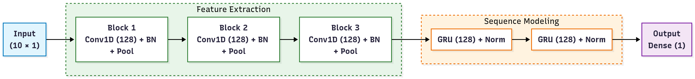

# FlowSync Documentation

## Architecture Overview

The timestamp generation module in FlowSync learns inter-packet interval (IPI) dynamics from replayed cloud gaming traces.

### Model Structure

The model takes a window of 10 consecutive IPIs (`shape: (None, 10, 1)`) and predicts the next IPI (`shape: (None, 1)`):

1. **Input Layer**: Window of 10 consecutive normalized IPIs.
2. **Convolutional Stages (Cascaded)**:
   - `Conv1D(128 filters, kernel_size=3, padding='same', activation='tanh')` $\to$ `BatchNormalization` $\to$ `MaxPooling1D(pool_size=2)`
   - `Conv1D(128 filters, kernel_size=5, padding='same', activation='tanh')` $\to$ `BatchNormalization` $\to$ `MaxPooling1D(pool_size=2)`
   - `Conv1D(128 filters, kernel_size=7, padding='same', activation='tanh')` $\to$ `BatchNormalization` $\to$ `MaxPooling1D(pool_size=2)`
3. **Recurrent Layers (Stacked GRU)**:
   - `GRU(128 units, activation='mish', return_sequences=True, dropout=0.2, kernel_regularizer=L1L2(0.001, 0.001))` $\to$ `LayerNormalization`
   - `GRU(128 units, activation='mish', return_sequences=False, dropout=0.2, kernel_regularizer=L1L2(0.001, 0.001))` $\to$ `LayerNormalization`
4. **Output Head**:
   - `Flatten` $\to$ `Dense(1, activation='tanh')`

### Timing Reconstruction

The predicted IPI values are inversely transformed from the $[-1, 1]$ scaled range using the per-trace `MinMaxScaler` and cumulatively summed ($t_n = t_0 + \sum_{i=1}^n \text{IPI}_i$) to reconstruct realistic packet timestamps in synthetic PCAP traces.

